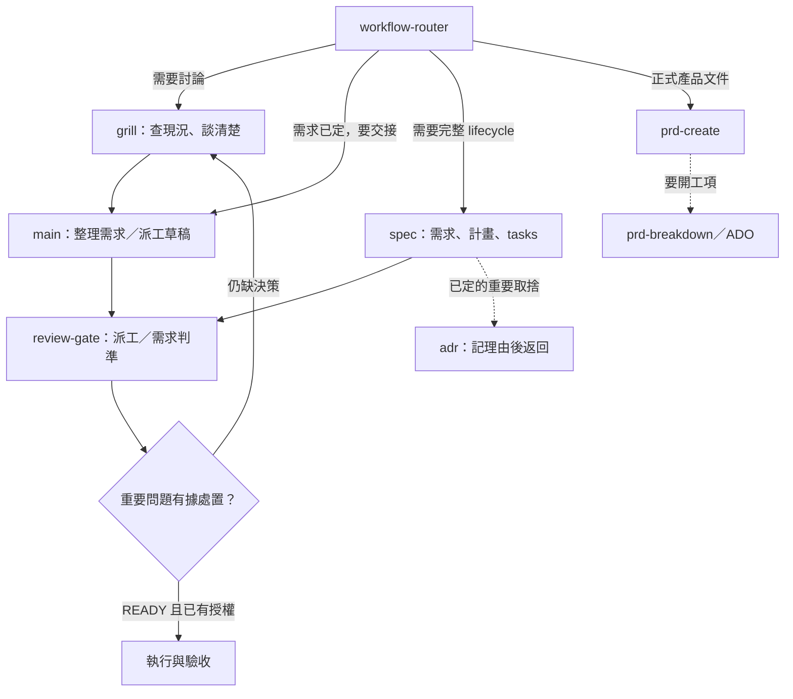
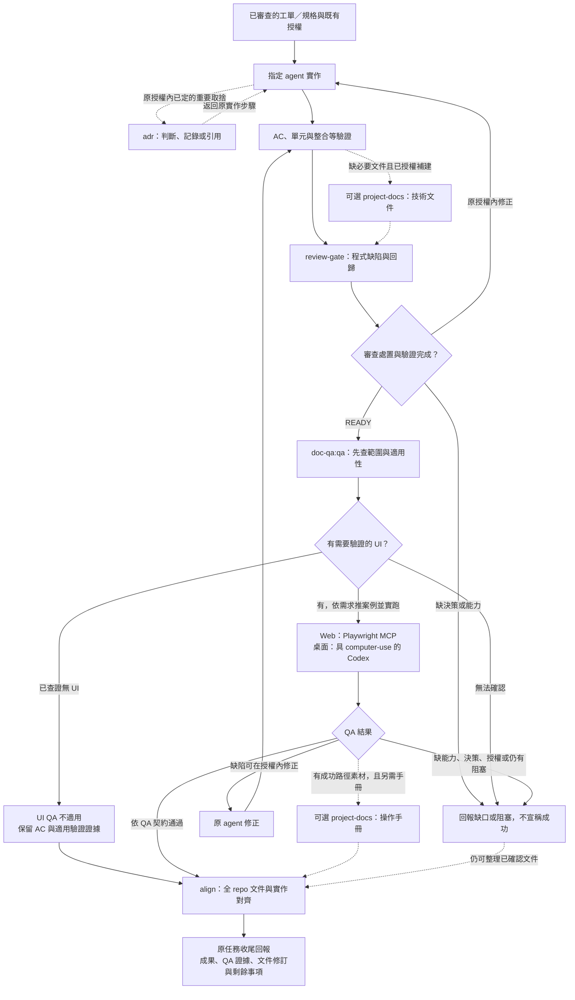

> **English summary:** The everyday path is discussion with grill, a dispatch drafted by the main agent, review-gate, then authorized execution and verification. Spec remains an optional full lifecycle. Review-gate shares fresh review and contextual adjudication across dispatch and code review. Tests, applicable UI QA and documentation alignment keep their separate evidence boundaries.

# 工作流與 skill 地圖

這包是一組依任務選用的工具，不是每個專案都要全部跑過一次。`workflow-router` 只分流，真正的工作交給對應 skill；以下圖中的箭頭是 agent 的工作指示，不是背景排程器或會自動啟動新 session 的程式。

## spec 一次會產出哪些依據

呼叫 [spec](../../spec/SKILL.md) 就會自動處理需求、計畫與任務拆分，不用再呼叫另一個 plan skill。`spec` 是流程名稱，`spec.md` 只是它產出的其中一份文件。

| 內容 | 回答什麼 | 保存位置 |
|---|---|---|
| FR／功能需求 | 要提供什麼行為 | spec.md；已有 PRD 可引用來源 |
| AC／驗收條件 | 怎樣可驗證它符合要求 | spec.md，對應 FR／需求與邊界 |
| 實作計畫 | 怎麼做、必要取捨、風險與順序 | 簡單功能：spec.md 的「實作計畫」；複雜功能：plan.md |
| 任務與進度 | 要執行哪些可驗證交付、做到哪 | tasks.md，連到唯一計畫位置並追溯 FR／AC |
| ADR（需要才有） | 為什麼選此方案、放棄什麼、接受什麼代價 | repo 自己的 ADR 位置；計畫只引用它 |

計畫不抄一次需求，tasks 不再寫一份規格。簡單功能可以只產 `spec.md`＋`tasks.md`，但不省掉 FR／AC 或做法。判斷是否需要獨立計畫，以及既有布局的處理，見 [spec 計畫判準](../../spec/references/review.md#計畫位置與內容)。

## 入口與規劃

實線是所選路線的接續；虛線是符合條件才接的分支。ADR 記錄已確定的決策，不能用來批准未決需求。PRD／ADO 不以是否有人類工程師分工來決定。

## 執行、QA 與文件同步

下圖是已授權完整開發任務的接續；工單由 main 寫，指定 agent 執行，沒有另一顆派工作者 skill。互動操作保留原階段閘門，不因圖上有 QA 就增加未授權工作。

- **QA 的需求依據**是已核准需求／spec；案例由 QA skill 產生，不能從目前行為反推成永遠會過的預期。
- **project-docs 不必每輪先跑。** 缺必要文件時可先補；操作手冊也能在 QA 後接實跑素材。它可以獨立執行，不是只存在於開發主線。
- **Web／桌面 QA**需有對應 driver；跨 UI 建議 Codex，但不能假定每個 Codex session 都有 computer-use。桌面分支需支援該 driver 的 doc-qa 版本及實際工具能力；工具或證據不足不能當測過。
- **受測產品只有 CLI／背景服務**時，先經 QA 適用性查核；依需求、入口與受影響呼叫鏈確認無 UI 才記不適用，使用原 AC／整合等證據後接 align。有 UI 卻缺工具或環境仍是未測。這與 agent 的執行方式無關：Claude Code bg session／agents 測 Web 仍走 Playwright。判準由 QA 的 ui-driver／report-contract 維護（doc-qa 0.2.1+／QA 0.5.1+）。
- **文件與驗收預期分開。** project-docs 的操作手冊及 align 描述實際可用步驟、版本與已知限制；需要盲測時另用已核准需求／AC 的驗收腳本，不把缺陷改成預期。歷史 ADR 可保留原文加有日期與證據的現況註記；決策改變仍需新 ADR。
- **ADR 不取代 spec 或變更授權。** 未決、超出授權或會改凍結規格時，先回報確認；不合 ADR 判準的決策留在原計畫即可。
- **align 可單獨呼叫。** 在 repo 說「文件對齊」或 `/align` 就能跑，不要求先走完整開發／QA。手動呼叫時先問範圍：只對齊某次改動影響到的文件（觸發範圍），或全庫重掃；上圖無人值守主線那一步預設全庫。跨 repo 可讀查證，修改其他 repo 先取明確授權；已部署環境唯讀。
- **未實跑或仍有缺陷**時，保留 QA 真實結果。可確定的文件仍可整理，但做完 align 不會把缺陷或證據缺口變成通過。上圖停止分支不能再被解讀為任務成功。
- **發布／正式部署／合併**沿本次授權；明確要做發布整備才另接 prep-repo，不因主線走完就自動發布。

## 這包有哪些 skill

以下依本 repo 的根目錄 `SKILL.md` 盤點：26 顆本地 skill，加上另由 doc-qa plugin 提供的 3 顆。這不是這台機器所有已安裝 skill 的總表；新增／移除本 repo skill 時同步更新此表與雙語 README。

| 類別 | Skills | 什麼時候找它們 |
|---|---|---|
| 工程主線與護欄 | [workflow-router](../SKILL.md)、[grill](../../grill/SKILL.md)、[spec](../../spec/SKILL.md)、[review-gate](../../review-gate/SKILL.md)、[adr](../../adr/SKILL.md)、[diagnose](../../diagnose/SKILL.md)、[align](../../align/SKILL.md)、[prep-repo](../../prep-repo/SKILL.md) | 選路、討論、設計／實作、派工與程式審查、決策、除錯、文件同步與發布整備 |
| 產品需求與工項 | [prd-create](../../prd-create/SKILL.md)、[prd-breakdown](../../prd-breakdown/SKILL.md) | 正式產品 PRD、多方需求確認、工項／ADO |
| 文件與內容 | [rewrite-tw](../../rewrite-tw/SKILL.md)、[rewrite-tone](../../rewrite-tone/SKILL.md)、[md2ppt](../../md2ppt/SKILL.md)、[conference-report](../../conference-report/SKILL.md) | 臺灣用語審校、語氣改寫、簡報、研討會素材重建與報告 |
| 圖像與模型 | [gpt-image-gen](../../gpt-image-gen/SKILL.md)、[character-lora](../../character-lora/SKILL.md)、[llm-benchmark](../../llm-benchmark/SKILL.md) | 生圖／修圖、角色 LoRA、地端模型實測 |
| 知識庫與收尾 | [llm-wiki-lint](../../llm-wiki-lint/SKILL.md)、[memory-lint](../../memory-lint/SKILL.md)、[wrap-up](../../wrap-up/SKILL.md) | Wiki／memory 結構檢查，或明確呼叫 `/wrap-up` 收整本次產出 |
| 研究與評估 | [searxng](../../searxng/SKILL.md)、[repo-scan](../../repo-scan/SKILL.md)、[ctf-kit](../../ctf-kit/SKILL.md)、[job-scout](../../job-scout/SKILL.md) | 搜尋、第三方 repo 評估、授權 CTF、公司／職缺調研 |
| 自動化與維運 | [skill-cron](../../skill-cron/SKILL.md)、[ios-resign](../../ios-resign/SKILL.md) | 明確要註冊排程，或 iOS App 重簽 |
| doc-qa plugin（另裝） | [project-docs](https://github.com/KerberosClaw/kc_ai_plugins/tree/main/plugins/doc-qa/skills/project-docs)、[qa](https://github.com/KerberosClaw/kc_ai_plugins/tree/main/plugins/doc-qa/skills/qa)、[md2pdf](https://github.com/KerberosClaw/kc_ai_plugins/tree/main/plugins/doc-qa/skills/md2pdf) | 文件盤點／補建／手冊、實機 QA、Markdown 轉 PDF |

日常可以直接 grill → main 工單 → review-gate → 執行與驗收；需要完整規格與進度管理才選 spec。程式完成後依任務跑測試與程式審查，完整開發任務再接適用 QA、align 與回報。goal-engineer 入口已退役，執行／恢復／通知紀律保留在 [grill 交接參考](../../grill/references/unattended-dispatch.md)，候選擇優模板留在 Git 歷史。手邊只是 hotfix 後文件沒跟上，直接 align。

review-gate 目前為 experimental：已做派工與程式碼的唯讀 dry run，但尚未證明修後收斂或回歸防止效果。缺少獨立 agent 能力不能假稱完成這一關。每種審查沿用專業判準；正式 PRD、ADR 與文件盲測不自動改成共用流程。
